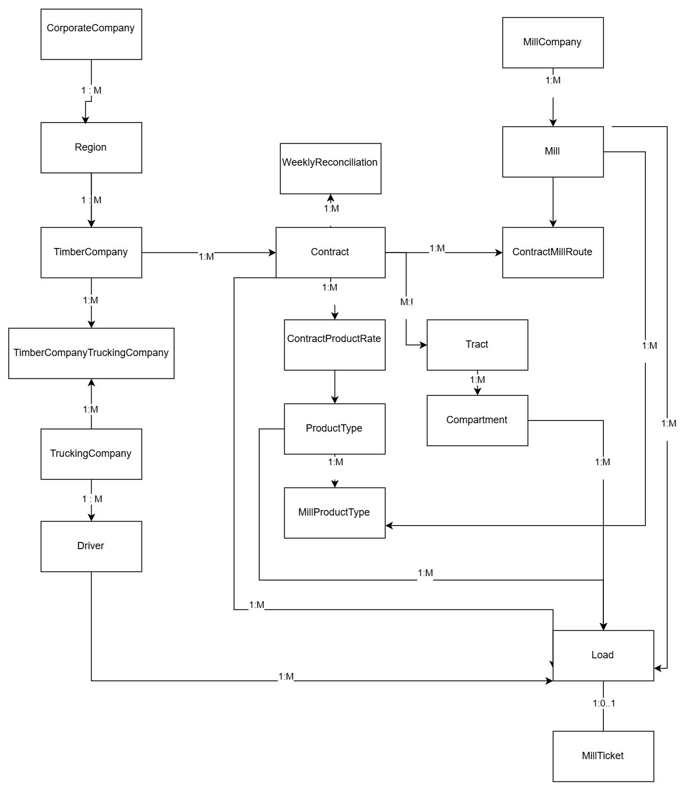

# # Timber Operations, Settlement, and Financial Analytics Platform

A SQL Server portfolio project designed to model timber operations, contract relationships, trucking companies, drivers, mills, product types, hauling routes, operational loads, mill tickets, and weekly reconciliation.

The project demonstrates relational database design, SQL development, data validation, QA practices, business analysis, and reproducible database deployment.

> All companies, contracts, drivers, mills, tracts, rates, and operational data used in this project are synthetic and created for demonstration purposes.

---

## Project Goals

The project was designed to answer business questions such as:

- Which timber companies belong to each corporate region?
- Which contracts are associated with each tract and timber company?
- Which mills are approved for each contract?
- What mileage and hauling rates apply to each contract/mill route?
- Which trucking companies and drivers are authorized to work with each timber company?
- How can operational load and settlement data be validated and reconciled?

The database separates organizational, contractual, transportation, mill, rate, and operational data into related tables so that business rules can be queried and tested consistently.

---

## Technologies Used

- Microsoft SQL Server
- SQL Server Management Studio (SSMS)
- T-SQL
- Relational database design
- diagrams.net / draw.io
- Git / GitHub
- Visual Studio Code

---

## Database Architecture

The core database contains 18 relational tables covering:

### Organizational Structure

- `CorporateCompany`
- `Region`
- `TimberCompany`

### Transportation

- `TruckingCompany`
- `Driver`
- `TimberCompanyTruckingCompany`

### Contracts and Tracts

- `Tract`
- `Contract`
- `Compartment`

### Mills, Products, and Rates

- `MillCompany`
- `Mill`
- `ProductType`
- `MillProductType`
- `ContractMillRoute`
- `ContractProductRate`

### Operations and Reconciliation

- `Load`
- `MillTicket`
- `WeeklyReconciliation`

---

## Entity Relationship Diagram

The ERD provides a high-level logical view of the major relationships in the system.



The diagram is intended as a logical overview rather than a full physical schema showing every column, constraint, and index.

---

## Reproducible Database Build

The database was tested by creating a separate clean database and rebuilding the schema from the project SQL scripts.

Recommended build order:

1. `03_create_database.sql`
2. `05_create_foundation_tables.sql`
3. `06_seed_foundation_data.sql`
4. `08_create_trucking_tables.sql`
5. `09_seed_trucking_data.sql`
6. `11_create_contract_tables.sql`
7. `12_seed_contract_data.sql`
8. `14_create_mill_product_rate_tables.sql`
9. `15_seed_mill_product_rate_data.sql`
10. `17_create_operational_tables.sql`

The seed scripts were also rerun to verify that they do not create duplicate reference data.

---

## Verification and QA

The project includes verification scripts that validate both row counts and relationships after the database is built.

Examples of validation performed include:

- expected table counts
- organizational relationships
- trucking company and driver relationships
- contract and tract relationships
- mill/product compatibility
- contract/mill routes
- product rates
- operational table creation
- seed-script repeatability

A clean release-test database was built from the scripts and successfully passed the verification suite.

### Expected Core Seed Counts

| Table | Expected Rows |
| --- | ---: |
| CorporateCompany | 1 |
| Region | 3 |
| TimberCompany | 6 |
| TruckingCompany | 4 |
| Driver | 8 |
| TimberCompanyTruckingCompany | 8 |
| Tract | 4 |
| Contract | 5 |
| Compartment | 5 |
| MillCompany | 3 |
| Mill | 6 |
| ProductType | 5 |
| MillProductType | 13 |
| ContractMillRoute | 4 |
| ContractProductRate | 6 |

The initial operational tables are intentionally empty:

- `Load`
- `MillTicket`
- `WeeklyReconciliation`

---

## Demonstration Queries

The `database/demo` folder contains business-oriented SQL examples.

### 01 - Organizational Hierarchy

**Business question:** Which timber companies belong to each region and corporate company?

**Intended grain:** One row per timber company.

Demonstrates:

- multi-table joins
- organizational hierarchy
- business-facing aliases
- result-set QA

---

### 02 - Contract, Tract, and Timber Company

**Business question:** Which contracts are associated with each tract and timber company?

**Intended grain:** One row per contract.

Demonstrates:

- choosing a driving table based on query grain
- contract relationships
- incremental join validation
- row-count QA

---

### 03 - Contract Mill Routes

**Business question:** Which mills are approved for each contract, and what mileage and hauling rates apply?

**Intended grain:** One row per contract/mill route.

Demonstrates:

- many-to-one relationships
- rate configuration
- route mileage
- contract/mill associations

---

## SQL Development and QA Approach

Queries in this project are built using a business-question-first workflow:

1. Define the business question.
2. Define the intended grain of the result set.
3. Identify the required tables.
4. Trace the relationships.
5. Choose the driving table.
6. Add joins one at a time.
7. Validate row counts after each join.
8. Apply filters.
9. Add business-facing output columns.
10. Verify the final results.

This approach helps identify accidental row multiplication, missing records, incorrect joins, and other data-quality issues before results are trusted.

---

## Repository Structure

```text
TimberDataPlatform
│
├── README.md
├── .gitignore
│
├── database
│   ├── schema and seed scripts
│   ├── demo
│   │   ├── 01_organizational_hierarchy.sql
│   │   ├── 02_contract_tract_company.sql
│   │   └── 03_contract_mill_routes.sql
│   │
│   └── verification
│       └── database verification scripts
│
├── docs
│   ├── TimberDataPlatform_ERD.drawio
│   ├── TimberDataPlatform_ERD.png
│   └── project design and data-quality notes
│
└── work-log
    └── development notes and project historyTimber Operations, Settlement, and Financial Analytics Platform

A SQL Server portfolio project designed to model timber operations, contract relationships, trucking companies, drivers, mills, product types, hauling routes, operational loads, mill tickets, and weekly reconciliation.

The project demonstrates relational database design, SQL development, data validation, QA practices, business analysis, and reproducible database deployment.

> All companies, contracts, drivers, mills, tracts, rates, and operational data used in this project are synthetic and created for demonstration purposes.

---

## Project Goals

The project was designed to answer business questions such as:

- Which timber companies belong to each corporate region?
- Which contracts are associated with each tract and timber company?
- Which mills are approved for each contract?
- What mileage and hauling rates apply to each contract/mill route?
- Which trucking companies and drivers are authorized to work with each timber company?
- How can operational load and settlement data be validated and reconciled?

The database separates organizational, contractual, transportation, mill, rate, and operational data into related tables so that business rules can be queried and tested consistently.

---

## Technologies Used

- Microsoft SQL Server
- SQL Server Management Studio (SSMS)
- T-SQL
- Relational database design
- diagrams.net / draw.io
- Git / GitHub
- Visual Studio Code

---

## Database Architecture

The core database contains 18 relational tables covering:

### Organizational Structure

- `CorporateCompany`
- `Region`
- `TimberCompany`

### Transportation

- `TruckingCompany`
- `Driver`
- `TimberCompanyTruckingCompany`

### Contracts and Tracts

- `Tract`
- `Contract`
- `Compartment`

### Mills, Products, and Rates

- `MillCompany`
- `Mill`
- `ProductType`
- `MillProductType`
- `ContractMillRoute`
- `ContractProductRate`

### Operations and Reconciliation

- `Load`
- `MillTicket`
- `WeeklyReconciliation`

---

## Entity Relationship Diagram

The ERD provides a high-level logical view of the major relationships in the system.


The diagram is intended as a logical overview rather than a full physical schema showing every column, constraint, and index.

---

## Reproducible Database Build

The database was tested by creating a separate clean database and rebuilding the schema from the project SQL scripts.

Recommended build order:

1. `03_create_database.sql`
2. `05_create_foundation_tables.sql`
3. `06_seed_foundation_data.sql`
4. `08_create_trucking_tables.sql`
5. `09_seed_trucking_data.sql`
6. `11_create_contract_tables.sql`
7. `12_seed_contract_data.sql`
8. `14_create_mill_product_rate_tables.sql`
9. `15_seed_mill_product_rate_data.sql`
10. `17_create_operational_tables.sql`

The seed scripts were also rerun to verify that they do not create duplicate reference data.

---

## Verification and QA

The project includes verification scripts that validate both row counts and relationships after the database is built.

Examples of validation performed include:

- expected table counts
- organizational relationships
- trucking company and driver relationships
- contract and tract relationships
- mill/product compatibility
- contract/mill routes
- product rates
- operational table creation
- seed-script repeatability

A clean release-test database was built from the scripts and successfully passed the verification suite.

### Expected Core Seed Counts

| Table | Expected Rows |
|---|---:|
| CorporateCompany | 1 |
| Region | 3 |
| TimberCompany | 6 |
| TruckingCompany | 4 |
| Driver | 8 |
| TimberCompanyTruckingCompany | 8 |
| Tract | 4 |
| Contract | 5 |
| Compartment | 5 |
| MillCompany | 3 |
| Mill | 6 |
| ProductType | 5 |
| MillProductType | 13 |
| ContractMillRoute | 4 |
| ContractProductRate | 6 |

The initial operational tables are intentionally empty:

- `Load`
- `MillTicket`
- `WeeklyReconciliation`

---

## Demonstration Queries

The `database/demo` folder contains business-oriented SQL examples.

### 01 - Organizational Hierarchy

**Business question:** Which timber companies belong to each region and corporate company?

**Intended grain:** One row per timber company.

Demonstrates:

- multi-table joins
- organizational hierarchy
- business-facing aliases
- result-set QA
---
### 02 - Contract, Tract, and Timber Company

**Business question:** Which contracts are associated with each tract and timber company?

**Intended grain:** One row per contract.

Demonstrates:

- choosing a driving table based on query grain
- contract relationships
- incremental join validation
- row-count QA

---

### 03 - Contract Mill Routes

**Business question:** Which mills are approved for each contract, and what mileage and hauling rates apply?

**Intended grain:** One row per contract/mill route.

Demonstrates:

- many-to-one relationships
- rate configuration
- route mileage
- contract/mill associations

---

## SQL Development and QA Approach

Queries in this project are built using a business-question-first workflow:

1. Define the business question.
2. Define the intended grain of the result set.
3. Identify the required tables.
4. Trace the relationships.
5. Choose the driving table.
6. Add joins one at a time.
7. Validate row counts after each join.
8. Apply filters.
9. Add business-facing output columns.
10. Verify the final results.

This approach helps identify accidental row multiplication, missing records, incorrect joins, and other data-quality issues before results are trusted.

---

## Repository Structure

```text
TimberDataPlatform
│
├── README.md
├── .gitignore
│
├── database
│   ├── schema and seed scripts
│   ├── demo
│   │   ├── 01_organizational_hierarchy.sql
│   │   ├── 02_contract_tract_company.sql
│   │   └── 03_contract_mill_routes.sql
│   │
│   └── verification
│       └── database verification scripts
│
├── docs
│   ├── TimberDataPlatform_ERD.drawio
│   ├── TimberDataPlatform_ERD.png
│   └── project design and data-quality notes
│
└── work-log
    └── development notes and project history
